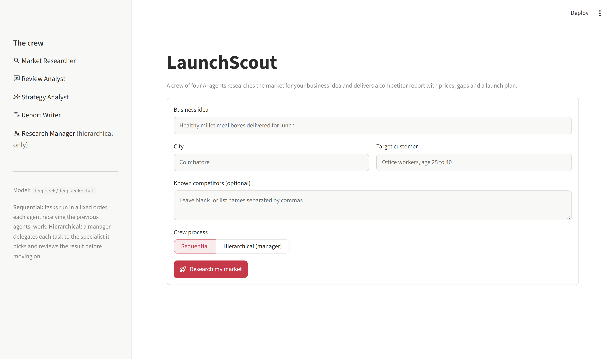
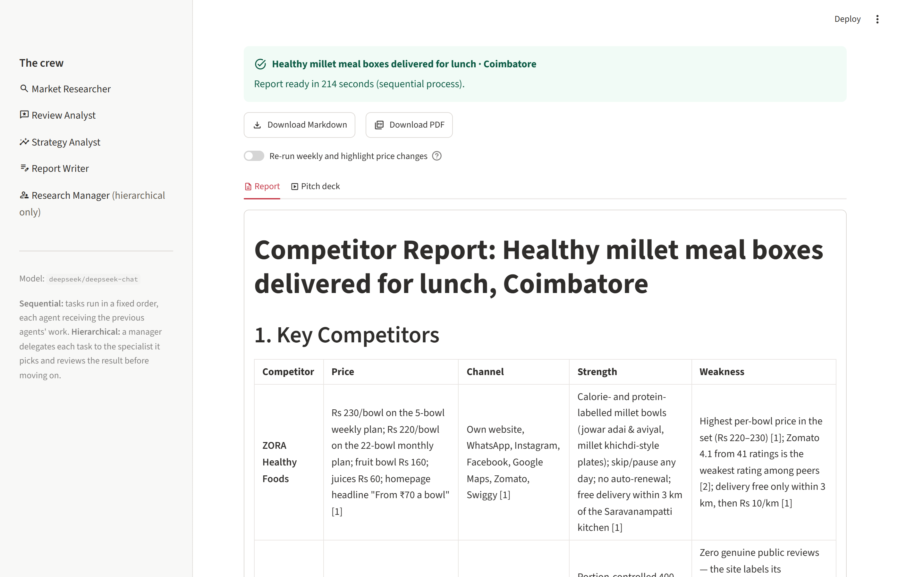
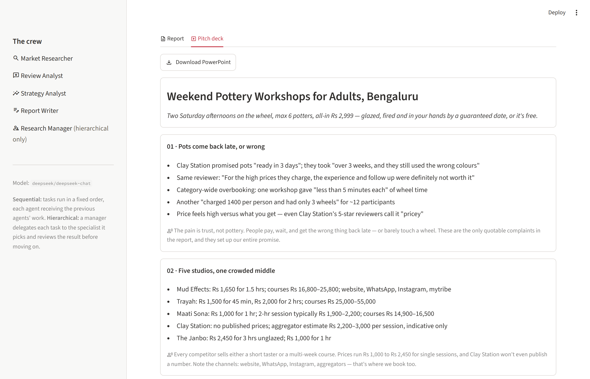
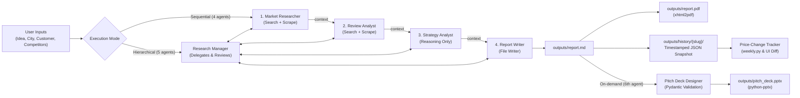

# LaunchScout

**Autonomous Multi-Agent Competitive Intelligence & Go-to-Market Crew**

LaunchScout is an end-to-end multi-agent AI system built with **CrewAI** and **Streamlit** that automates real-time local market research for new business ideas. Given a business concept, city, target customer, and optional known competitors, LaunchScout deploys a specialized crew of AI agents to search live web sources, extract verified competitor pricing, mine recurring customer complaints, identify the clearest market gap, recommend defensible positioning, and deliver an actionable 30-day launch plan—exported as **Markdown**, **PDF**, and an investor-ready **PowerPoint pitch deck**.

---

## Table of Contents

- [Product Preview](#product-preview)
- [The Real-World Business Problem](#the-real-world-business-problem)
- [Key Features](#key-features)
- [Framework & Technology Stack](#framework--technology-stack)
- [Multi-Agent Architecture](#multi-agent-architecture)
- [How Execution Works](#how-execution-works)
- [How the Stretch Goals Are Achieved](#how-the-stretch-goals-are-achieved)
- [Project Layout](#project-layout)
- [Setup & Installation](#setup--installation)
- [Usage](#usage)
- [Quality Verification](#quality-verification)
- [Known Limitations](#known-limitations)

---

## Product Preview

### Research Form & Crew Process Selector
Configure the business idea, city, target customer, optional known competitors, and choose between **Sequential** and **Hierarchical (manager)** orchestration:



### Source-Cited Competitor Report, Exports & Weekly Tracking
View the structured 6-section report with inline `[1]` source citations, download **Markdown** or **PDF**, and toggle **Re-run weekly** to track competitor price changes:



### On-Demand 6-Slide Pitch Deck with Speaker Notes
Generate a founder-ready 6-slide presentation (with presenter speaker notes and PowerPoint `.pptx` export) powered by the **Pitch Deck Designer** agent:



---

## The Real-World Business Problem

Founders, operators, and small-business teams validating a new local offering face a painful research bottleneck:

1. **Fragmented, fast-changing local data:** Pricing, offers, and delivery channels are scattered across company websites, food/service aggregators (Swiggy, Zomato), directories (Justdial, Google Maps), and social channels (Instagram, Reddit).
2. **Manual research is slow and inconsistent:** Compiling a reliable competitor matrix and reading through hundreds of customer reviews typically takes days of manual work—and quickly goes stale when competitors adjust prices.
3. **Generic AI tools hallucinate market data:** Standard single-prompt LLM chats frequently invent businesses, fabricate prices, and provide vague strategy advice without verifiable evidence.

### How LaunchScout Solves It

LaunchScout turns days of fragmented market validation into an automated **3–5 minute** evidence-backed workflow:

- **Live web grounding:** Agents query live Google search results via Serper and scrape real pages to capture current local prices, offers, and sales channels.
- **Signal over noise:** Customer feedback is systematically grouped across competitors so founders see shared, recurring market pain points rather than isolated anecdotes.
- **Zero-hallucination evidence chain:** Every price and claim is traced back to its exact URL using inline numbered citations (`[1]`, `[2]`, …). The strategist has no web access and reasons strictly over verified evidence collected by the researchers.
- **Actionable deliverables, not raw notes:** Outputs are structured for immediate founder execution—a 6-section decision report, printable PDF, 6-slide pitch deck with speaker notes, and ongoing weekly price-change alerts.

---

## Key Features

- **Source-Verified Competitive Reports:** Produces a standardized 6-section report (*Key Competitors, Customer Complaints, Market Gap, Recommended Positioning, 30-Day Launch Plan, Sources*) with inline citations linked to live URLs.
- **Dual Orchestration Modes:** Switch seamlessly between a fast **Sequential** pipeline (4 agents) and a manager-supervised **Hierarchical** workflow (5 agents, including a Research Manager that delegates and reviews).
- **Real-Time Streaming Web UI:** Interactive Streamlit interface displaying live per-agent progress, tool invocations (queries, scraped URLs, file writes), intermediate task handoffs, and session replay.
- **Multi-Format Exports:** One-click downloads for Markdown (`report.md`), clean A4 Unicode-ready PDF (`report.pdf`), and a branded 16:9 PowerPoint deck (`pitch_deck.pptx`) with speaker notes.
- **Automated Weekly Price Monitoring:** Archives timestamped JSON snapshots of every run, detects competitor price changes, new entrants, and disappearances across runs, and supports scheduled weekly re-runs.
- **Cloud & Local LLM Support:** Works with the **DeepSeek API** (recommended) or local open-source models via **Ollama** through CrewAI/LiteLLM, with automatic iteration-limit and timeout tuning.
- **Built-in Diagnostic & QA Scripts:** Includes `check_setup.py` to validate LLM/tool connectivity before running, and `check_report.py` to programmatically audit report structure, pricing coverage, and citation integrity.

---

## Framework & Technology Stack

| Layer | Technology | Role in LaunchScout |
|---|---|---|
| **Agent Orchestration** | **CrewAI** (`crewai>=0.100`) | Defines agents, tasks, context chaining, `Process.sequential` / `Process.hierarchical`, and real-time `crewai_event_bus` telemetry |
| **Agent Tools** | **CrewAI Tools** (`crewai-tools>=0.40`) | `SerperDevTool` (Google search, 8 results/query), `ScrapeWebsiteTool` (page reader), `FileWriterTool` (sandboxed to `outputs/`) |
| **LLM Routing** | **LiteLLM** (via CrewAI `LLM`) | Unified interface for DeepSeek API (`deepseek/deepseek-chat`) and local Ollama models (`ollama/*`) |
| **Web Interface** | **Streamlit** (`streamlit>=1.40`) | Input form, live event-driven agent trace, tabbed report/deck viewer, price-change diff badges, and file downloads |
| **Schema Validation** | **Pydantic** | Validates structured pitch deck JSON output (`PitchDeck` & `Slide` models) before rendering slides |
| **Document Export** | **Markdown + xhtml2pdf + ReportLab** | Converts Markdown reports to styled A4 PDFs with Unicode TTF font registration (supporting `₹`, dashes, quotes) and clickable links |
| **Slide Generation** | **python-pptx** | Programmatically renders a consistent 16:9 PowerPoint presentation with speaker notes from validated JSON |

---

## Multi-Agent Architecture

LaunchScout uses **6 distinct specialized agents** in total across its core pipeline, hierarchical mode, and on-demand deck builder:

- **4 Core Agents** run in every standard sequential market-research run.
- **5 Agents** run when **Hierarchical mode** is selected (4 specialists + 1 Research Manager).
- **1 On-Demand Agent** (Pitch Deck Designer) runs after report completion whenever the user generates slides.

| # | Agent Role | Mode | Tools Equipped | Responsibility |
|---|---|---|---|---|
| 1 | **Market Researcher** | Core (always) | `SerperDevTool`, `ScrapeWebsiteTool` | Finds 3–5 real direct (or labeled substitute) competitors operating in the target city; records prices, offers/plans, sales channels, and exact source URLs. |
| 2 | **Review Analyst** | Core (always) | `SerperDevTool`, `ScrapeWebsiteTool` | Mines public reviews (Google Maps, Zomato, Swiggy, Justdial, Reddit, Instagram, YouTube, blogs) per competitor; separates praise from complaints and surfaces recurring market-wide pain points. |
| 3 | **Strategy Analyst** | Core (always) | *None* (pure reasoning) | Operates strictly on teammates' verified data—builds the comparison matrix, identifies the single clearest market gap, and proposes a one-line positioning statement with a defensible local-currency price. |
| 4 | **Report Writer** | Core (always) | `FileWriterTool` (locked to `outputs/`) | Synthesizes all findings into the exact 6-section Markdown report with numbered inline citations `[1]`, a 4-week 30-day launch plan, and a full Sources section saved to `outputs/report.md`. |
| 5 | **Research Manager** | Hierarchical only | CrewAI delegation & Q&A tools (`allow_delegation=True`) | Supervises the 4 core specialists—assigns each task to the right agent, passes prior context, verifies prices/links/sections, and requests at most one revision if required evidence is missing. |
| 6 | **Pitch Deck Designer** | On-demand (Pitch deck tab) | *None* (report synthesis) | Transforms the completed report into a concise, investor-ready 6-slide JSON specification (title, 3–5 short bullets, speaker notes) for PowerPoint rendering. |

### Agent Pipeline Flow



---

## How Execution Works

### 1. Input Normalization & Dynamic Task Templating
When a run starts (via `app.py`, `main.py`, or `weekly.py`), `clean_inputs()` validates and normalizes `{business_idea}`, `{city}`, `{target_customer}`, and `{known_competitors}`. CrewAI interpolates these placeholders into every agent's goal and task prompt, enabling the exact same codebase to research any industry in any city.

### 2. Context Chaining & Strict Output Contracts
In `launchscout/tasks.py`, the four core tasks form a directed evidence chain via CrewAI's `context` parameter:
1. `research_task` → outputs 3–5 structured competitor profiles with URLs.
2. `review_task(context=[research])` → researches reviews for those exact competitors and extracts shared market complaints.
3. `strategy_task(context=[research, reviews])` → builds the matrix, market gap, and priced positioning strictly from verified findings.
4. `report_task(context=[research, reviews, strategy])` → writes the 6-section cited report and guarantees persistence via both `FileWriterTool` and CrewAI's `output_file=str(REPORT_PATH)`.

Every task enforces an explicit `expected_output` schema so downstream agents, `extract_prices()`, and `check_report.py` can rely on a predictable format.

### 3. Resilient Web Research & Model Adaptation
- **Anti-loop scraping guardrails:** `SCRAPE_TIP` instructs agents never to retry blocked or timed-out sites (such as Justdial or Google Maps) and instead fall back to verified search snippets and their URLs.
- **Backend-aware limits:** `launchscout/config.py` and `launchscout/agents.py` automatically adjust execution limits—using `max_iter=15` and a 180s timeout for cloud APIs (DeepSeek), and `max_iter=25` with a 600s timeout for local Ollama models.

### 4. Real-Time Event Streaming in the Web UI
To keep Streamlit responsive during a 3–5 minute run (`launchscout/progress.py`):
- `run_with_progress()` launches `crew.kickoff()` inside a **background daemon thread**.
- It subscribes to CrewAI's global `crewai_event_bus` (`AgentExecutionStartedEvent`, `ToolUsageStartedEvent`, `ToolUsageFinishedEvent`, `ToolUsageErrorEvent`, `TaskCompletedEvent`, `TaskFailedEvent`), filters events strictly to the active crew's agent IDs, and translates raw tool payloads into concise human-readable descriptions.
- Events flow through a thread-safe `queue.Queue` to Streamlit's `ProgressView`, updating expandable `st.status` containers live and storing the full log in `st.session_state` for post-run replay.
- **Tab-close safety:** The worker thread saves the timestamped snapshot and renders `report.pdf` before emitting the final `done` event, ensuring outputs persist to disk even if the browser tab is closed mid-run.

---

## How the Stretch Goals Are Achieved

All three stretch goals are fully integrated into both the architecture and user experience:

### 1. Hierarchical Manager-Led Process (`Process.hierarchical`)
- **How it works:** Selecting **Hierarchical (manager)** in the UI or passing `--process hierarchical` on the CLI invokes `build_crew(process="hierarchical")` in `launchscout/crew.py`.
- **Implementation:**
  - Tasks are built with `assign_agents=False`, leaving task ownership unassigned so CrewAI hands orchestration control to `research_manager()`.
  - The **Research Manager** (`allow_delegation=True`, no external web tools) receives explicit working rules in its backstory: handle only the active task, delegate to the right specialist, preserve filenames like `report.md`, and send work back **at most once** if prices, source links, or required sections are missing.
  - In `app.py`, `ProgressView(hierarchical=True)` adapts its live timeline so the Research Manager container remains active across the full run while delegated specialists open, log tool calls, and close upon handoff.

### 2. On-Demand Pitch Deck Agent (`launchscout/pitch_deck.py`)
- **How it works:** After any report completes, opening the **Pitch deck** tab and clicking **Make pitch deck** runs a dedicated 6th agent (**Pitch Deck Designer**) in ~30 seconds.
- **Implementation:**
  - Uses a fixed 6-slide narrative blueprint (*The Problem → The Market Today → The Gap → Our Offer → Why We Win → 30-Day Launch Plan + Ask*), grounded strictly in numbers from the finished report.
  - Rather than relying on CrewAI's `output_pydantic` (which requires strict JSON-schema `response_format` support that DeepSeek does not support), the agent outputs raw JSON which `_parse_deck()` extracts and validates through **Pydantic** (`PitchDeck` and `Slide` models with word/bullet constraints).
  - `render_pptx()` uses **python-pptx** to separate content from design—generating a branded 16:9 presentation (title slide + 6 numbered content slides), automatically stripping inline `[1]` citation markers from slide bullets, and embedding `speaker_notes` into each slide's PowerPoint presenter notes.

### 3. Weekly Re-Runs & Competitor Price-Change Tracking (`launchscout/tracking.py`, `weekly.py`)
- **How it works:** Every finished report is automatically saved as a dated snapshot; turning on **Re-run weekly and highlight price changes** schedules ongoing competitive tracking.
- **Implementation:**
  - **Snapshot storage:** `save_snapshot()` writes `created`, `inputs`, extracted `prices`, and full `report` JSON into `outputs/history/<idea-city-slug>/<YYYYMMDD-HHMMSS>.json`.
  - **Deterministic price extraction:** Because Section 1 of every report follows a strict Markdown table (`Competitor | Price | ...`), `extract_prices()` parses competitor names and prices directly without extra LLM calls.
  - **Fuzzy matching & numeric comparison:** `_key()` normalizes competitor names (so `"Cake Bee (KK Nagar)"` matches `"Cake Bee"`), while `_numbers()` compares numeric price values across the latest two snapshots to classify each competitor into `PRICE CHANGED`, `NEW`, `NOT FOUND`, or `same`.
  - **Automated scheduling:** Toggling tracking persists the idea and process mode to `outputs/tracked.json`. Running `weekly.py` (manually or via Windows Task Scheduler / cron) re-runs every tracked idea, saves updated snapshots and PDFs, and writes a Markdown diff summary to `outputs/history/<slug>/changes-YYYYMMDD.md`—while the Streamlit UI renders color-coded status badges automatically on subsequent runs.

---

## Project Layout

```text
LaunchScout/
├── app.py                     # Streamlit web UI (form, live agent stream, PDF/MD downloads, pitch deck, price diffs)
├── main.py                    # CLI runner for one-off sequential or hierarchical research runs
├── weekly.py                  # Batch runner for tracked ideas + weekly price-change diff reports
├── check_setup.py             # Pre-flight smoke test (LLM, Serper search, scraper, file writer)
├── check_report.py            # Automated QA validator checking all 6 sections, prices, citations, and 4-week plan
├── requirements.txt           # Python dependencies
├── .env.example               # Configuration template for DeepSeek / Ollama and Serper keys
├── launchscout/
│   ├── config.py              # Loads .env, auto-creates outputs/, builds LLM client with backend-aware timeouts
│   ├── tools.py               # SerperDevTool, ScrapeWebsiteTool, sandboxed FileWriterTool
│   ├── agents.py              # 4 core specialist agents + Research Manager agent
│   ├── tasks.py               # 4 chained tasks with strict expected_output contracts & scraping guardrails
│   ├── crew.py                # Crew assembly (sequential vs. hierarchical) and input normalization
│   ├── progress.py            # Background worker thread + crewai_event_bus queue streamer for Streamlit
│   ├── pdf.py                 # Markdown-to-PDF converter (Unicode font support, link shortening, A4 styling)
│   ├── pitch_deck.py          # Pitch Deck Designer agent, Pydantic validator, and python-pptx 16:9 renderer
│   └── tracking.py            # Snapshot history, Section 1 price extraction, fuzzy diffing, tracked.json store
├── docs/screenshots/          # Playwright-captured UI screenshots embedded in this README
└── outputs/                   # Auto-created at runtime, ignored by git (report.md, report.pdf, pitch_deck.pptx, history/)
```

---

## Setup & Installation

### Prerequisites
- **Python 3.10–3.13** *(CrewAI does not support Python 3.14 yet)*
- A **Serper API key** from [serper.dev](https://serper.dev) *(free tier includes 2,500 searches)*
- Either a **DeepSeek API key** from [platform.deepseek.com](https://platform.deepseek.com) *(recommended)* **or** a local **Ollama** installation

### Installation (Windows PowerShell)

```powershell
# 1. Create and activate a virtual environment
py -3.12 -m venv .venv
.\.venv\Scripts\Activate.ps1

# 2. Install dependencies
pip install -r requirements.txt

# 3. Create your environment file and add API keys
Copy-Item .env.example .env

# 4. Verify LLM, search, scraper, and file writer connectivity
python check_setup.py
```

### Environment Configuration (`.env`)

| Variable | Description | Default / Example |
|---|---|---|
| `MODEL` | LLM identifier routed via LiteLLM (`deepseek/...` or `ollama/...`) | `deepseek/deepseek-chat` |
| `DEEPSEEK_API_KEY` | API key for DeepSeek *(required when `MODEL` starts with `deepseek/`)* | — |
| `OLLAMA_BASE_URL` | Local Ollama server endpoint *(used when `MODEL` starts with `ollama/`)* | `http://localhost:11434` |
| `SERPER_API_KEY` | Web search API key for Market Researcher & Review Analyst | — |
| `TEMPERATURE` | Model sampling temperature *(lower = more factual)* | `0.2` |

> **Tip:** Keep only one active `MODEL=` line in `.env` (if multiple exist, the last one takes precedence).

---

## Usage

### 1. Streamlit Web App (Recommended)

```powershell
streamlit run app.py
```

Enter your business idea, city, target customer, and optional known competitors, choose **Sequential** or **Hierarchical (manager)**, and click **Research my market**. Once complete, download the Markdown or PDF report, toggle weekly tracking, or generate a 6-slide PowerPoint pitch deck.

### 2. Command Line Interface

```powershell
# Run with default sample (Healthy millet meal boxes, Coimbatore)
python main.py

# Run with custom inputs
python main.py --idea "Pet grooming at home" --city "Chennai" --customer "Pet owners"

# Include known competitors and run with the Research Manager (hierarchical mode)
python main.py --idea "Specialty filter coffee kiosk" --city "Bengaluru" --customer "Tech park commuters" --competitors "Third Wave Coffee, Blue Tokai" --process hierarchical
```

A typical sequential run takes **3–5 minutes** and performs roughly **60–110** web searches and page reads. Hierarchical runs take longer because the Research Manager delegates and reviews each step.

### 3. Automated Weekly Price Tracking

First, enable **Re-run weekly and highlight price changes** on any completed report in the web app (this saves the idea to `outputs/tracked.json`). Then run manually or schedule it:

```powershell
# Run manually
python weekly.py

# Schedule every Monday at 09:00 via Windows Task Scheduler (run from the project directory)
schtasks /Create /SC WEEKLY /D MON /ST 09:00 /TN LaunchScoutWeekly /TR "\"$PWD\.venv\Scripts\python.exe\" \"$PWD\weekly.py\""
```

---

## Quality Verification

LaunchScout includes an automated report auditor (`check_report.py`) that verifies any generated report against the project's completeness standards:

```powershell
python check_report.py                      # Audits outputs/report.md
python check_report.py path/to/report.md    # Audits a specific report file
```

It validates:
1. All 6 required numbered sections are present.
2. At least 3 competitors include numeric pricing.
3. Every competitor row in Section 1 cites at least one source (`[n]`).
4. Section 6 contains a valid `http(s)://` URL for every distinct inline citation used in the report.
5. Section 5 covers all four weeks (`Week 1` through `Week 4`).

---

## Known Limitations

- **Anti-scraping sites:** Platforms such as Justdial and Google Maps frequently block direct scraping. Agents are instructed to use verified search snippets and their URLs instead of retrying blocked pages.
- **Aggregator & snippet estimates:** Where businesses do not publish official menu/pricing pages, prices may be sourced from search snippets or aggregator estimates. Reports label these accordingly—verify estimates before using them in financial models.
- **Small local LLMs:** Models in the 7B–9B range (via Ollama) follow strict Markdown table and JSON formatting rules less reliably than DeepSeek API models; larger models or DeepSeek are recommended for production runs.
